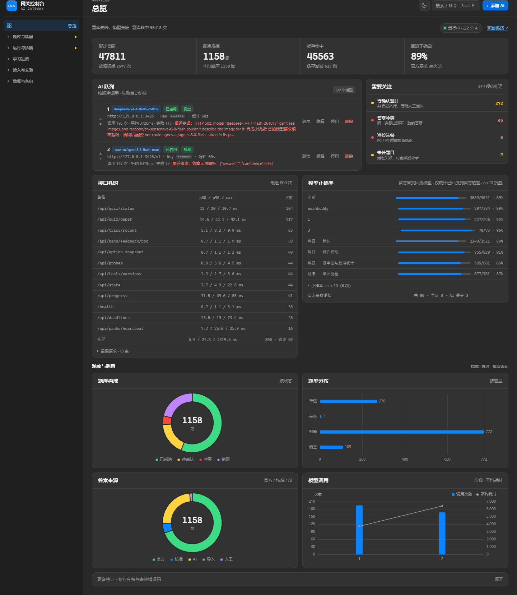

# OCS AI 网关

给 [OCS 网课助手](https://github.com/ocsjs) 用的本地 AI 题库服务。


比原版 `ocsjs-knowledge-ext` 多做四件事：

- **多个 AI 排队用**：按顺序调用，前一个超时 / 报错 / 答案解析不出来，自动换下一个
- **网页管理台**：在浏览器里增删 AI、填 Key、调顺序、点一下测试连通，不用改 `.env`、不用重启
- **答案缓存**：同一道题只花一次 token，重复刷到秒答
- **Key 只在本机**：全部存在 `data/providers.json`，不经过任何第三方

对外暴露的接口和 OCS 的 `AnswererWrapper` 完全兼容，OCS 那边配置一次就行。



---

## 一、快速开始

### 1. 准备 uv（二选一）


**方式 A：绿色便携（推荐，整个文件夹拷走就能用）**

去 [uv releases](https://github.com/astral-sh/uv/releases/latest) 下载 `uv-x86_64-pc-windows-msvc.zip`，解压出 `uv.exe`，放到本项目根目录，和 `start.bat` 放在一起：

```
ocs-ai-gateway\
├── uv.exe          ← 放这里
├── start.bat
└── main.py
```

脚本会优先使用它，找不到才会去系统里找。ARM 版 Windows 请下 `uv-aarch64-pc-windows-msvc.zip`。

**方式 B：安装到系统（一次性）**

在 PowerShell 执行，装完关掉终端重开：

```powershell
powershell -ExecutionPolicy ByPass -c "irm https://astral.sh/uv/install.ps1 | iex"
```

两种方式都会被自动识别，不需要改脚本。

### 2. 双击 `start.bat`

首次运行会自动装依赖（几分钟），然后：

- 窗口里出现 `Uvicorn running on http://127.0.0.1:8000`
- 浏览器自动打开管理台 <http://127.0.0.1:8000/admin>
- 点右上角 **「+ 添加 AI」**，填四项：

| 字段 | 填什么 |
|---|---|
| 名称 | 随便，比如 `DeepSeek` |
| Base URL | `https://api.deepseek.com/v1`（一般以 `/v1` 结尾） |
| 模型名称 | `deepseek-chat` |
| API Key | `sk-...` |

保存后点该条目的 **「测试」**，出现「✅ 连通正常」就说明能答题了。

### 3. 接到 OCS 上

管理台下方有 **「接入 OCS」** 区块，点「复制 JSON」，然后：

1. 打开 OCS 桌面端启动的浏览器，点悬浮面板 → **设置 → 题库配置**
2. 清空原有内容，粘贴，保存

之后回到课程页就会自动答题。本页增删 AI 立即生效，**不需要再动 OCS 配置**。

> 以后每次使用：双击 `start.bat` → 等窗口起来 → 开 OCS 答题。想单独打开管理台就双击 `admin.bat`。

---

## 二、管理台能做什么

每个功能面板标题旁有一个完成度徽章，含义如下：

| 徽章 | 含义 |
|---|---|
| **闭环** | 开关或保存后自动生效，无需人工收尾 |
| **半自动** | 生成候选或建议，需人工确认才写库 |
| **依赖外部** | 需要模型 / 用户脚本 / 第三方服务，缺失时降级或为空 |

| 操作 | 说明 |
|---|---|
| 添加 / 编辑 | Key 编辑时留空表示不修改，不会把已有 Key 清掉 |
| 上移 / 下移 | 决定调用顺序，上面的先用 |
| 停用 / 启用 | 临时下线某个 AI，不用删 |
| 测试 | 用一道真题（"中国首都是？"）实打实调一次，返回答案和耗时 |
| 清空缓存 | 换模型或发现某题答案记错了，清掉重答 |

页面每 15 秒自动刷新统计数据：累计答题、缓存命中、故障切换次数、每个 AI 的调用次数与最近错误。

### 答题链路可视化

打开 <http://127.0.0.1:8000/trace>（管理台左侧「答题链路」也能进入）。页面按「先看结论、再看解题过程、最后才看深层数据」的顺序排列：

- **结论条**：最终答案 / 来源 / 置信度 / 共识 / 耗时 / Token 放在最上面，不用滚到底；失败和风险答案直接染红或标黄。
- **答案可靠度**：紧接结论条，按「来源（官方/题库/缓存/AI）→ 票数与份额 → 异议 → 输入是否截断 → risk 标记」逐项列出事实并判高/中/低，不生成看起来像准确率的分数；票数打平、单模型孤证、题干截断都会明确写出来。
- **模型做题对照**：每个模型一行 —— 答案、与最终答案是否一致（一致 / 异议 / 失败 / 无答案）、自评置信度、耗时、Token；异议行标红，点行可看该模型的原始输出。
- **题目**：完整题干、选项、图片转写，外加「题目接收」标记 —— 题干多少字、选项几个、模型是否收到被截断的版本（超限时给出明确警告）。
- **链路**：官方题库 → 题库匹配 → 选项快照 → 答题记忆 → 答案缓存 → 提示词准备 → AI 作答 → 投票 → 交叉验证，一行看完命中 / 跳过 / 失败。
- **模型思考**：每个模型一条可折叠记录，胜出的模型默认展开，异议/失败模型在标题上带标签；推理原文保留换行，最多保留 4000 字，框内滚动。思考内容兼容 `reasoning_content` / `reasoning` / `thinking` / responses 的 `summary`，模型答错时也保留已产生的思考。批量调用会提示「不记录逐模型思考」，答案见批次表。
- **深层信息**：瀑布图 / 模型卡片 / 事件流折叠在底部 —— 要排查「慢在哪、谁失败了」时再展开，不抢占阅读位置。
- **筛选与回看**：按题干搜索，按来源（官方 / 题库 / 记忆 / 缓存 / AI）和状态过滤，按最新 / 最慢 / Token 排序；`/trace?seq=12` 可直接定位某条轨迹；批次头可点，只看本批。

页面每 700ms 轮询一次，最近 50 条轨迹保存在内存；重启网关即清空。轮询重渲染会保留折叠状态和滚动位置，正在看的那段推理不会被打断。不记录提示词正文与模型原始输出，只保留解析后的答案、思考内容、错误与 Token 统计。

### 批量预取（`/api/batch/query`）

整页题目一次交给网关：先查题库 / 答题记忆 / 缓存，剩下的才按字符预算分片交给 AI，结果按 `id` 对齐返回并写回缓存。完整契约见 [`docs/api-batch.md`](docs/api-batch.md)。

- **两种模式**：`mode=answer` 直接返回答案；`mode=prefetch` 只预热缓存、**不返回答案**。
- **默认关闭**：`BATCH_ENABLED` 默认 `0`，关闭时接口返回 404；管理台「答题策略 → 批量答题」可单独打开。
- **油猴面板**：「本页预取 N 题」按钮把当前页前 30 题按 `prefetch` 发过去，显示 `已缓存 x / 共 y`；**不接管** OCS 官方 handler，官方仍逐题请求，命中缓存即秒回。
- **回退单题**：图片题、超 30 题、解析失败的题都退回单题完整链路，保证不比逐题慢路径差。
- **可观测**：`/trace` 页按批次折叠（批次头点一下只看本批），批量调用单独一条 trace，展开能看到本批每题的答案与置信度；`GET /api/trace/recent?batch_id=...` 可过滤。

### 本地题库

管理台的「本地题库」面板可录入单选/多选/判断的题目和标准答案，存在 `data/bank.json`。答题时**先查本地题库**：同一专业内题型一致、选项集合一致、题干相似度 ≥ 0.9 即命中，直接返回不调 AI；未命中才走 AI。AI 答完的题会自动入库为「待确认」（可按专业筛选、一键采纳/删除）。

- 专业隔离：题目带 `subject` 字段；管理台可筛选，OCS 配置里的 `subject` 决定查哪个题库（每门课粘贴一份带不同 `subject` 的配置即可互不串题）。
- 纠错累积：AI 自动入库的题是「待确认」，每次再遇到都会重新问一次 AI 做对比——连续 2 次答案一致自动采纳（之后秒答）；答案不一致则旧答案写入历史、标记「冲突」，管理台可查看历史答案并编辑/采纳。手动改答案也视为已确认并保留旧答案。
- 统计与缓存：累计答题等统计写在 `data/stats.json`，重启/更新服务不会清零；管理台「缓存转题库」可把未过期的缓存导入题库（新格式缓存带题型/选项，旧缓存会自动跳过）。
- 缓存失效：题库记录被修改或删除时（人工纠错、采纳、标记错题、批量操作、官方答案回流），会按「题型 + 题干」清掉对应答案缓存，避免题库已纠正、缓存还返回旧答案。
- 错题回炉：管理台单条「标记错误」或批量标记。标记后清空当前答案、回到待确认，并把这个错误答案记入错题集；模型再给出同一个错误答案也不会自动采纳，必须换出新答案且连续 2 次一致才转为已采纳。
- 图片题入库：按「图片指纹（sha256）+ 题型 + 选项」匹配，不比对题干；同图同题第二次可直接秒答，不同图不会串题。图片只存指纹不存 base64。
- 自动分类：管理台「课程自动分类」可编辑「专业名 + 关键词」规则（存 `data/subjects.json`）。OCS 配置里的 `subject` 为空或填「默认」时，按题干/选项关键词自动归类；显式填写的专业优先。
- 交叉验证：管理台「答题策略」可开「双模型交叉验证」——两个不同模型**并发**作答，答案一致才采纳（写入标准答案），不一致记冲突待确认；不一致的题不写缓存，下次还会再验证。需要至少两个启用的 AI。
- 图片两阶段：开启后图片题先让视觉模型转写（转写结果按图片指纹缓存），再交文本模型作答；同一图片第二次不再重复转写。
- 批量导入：本地题库支持导入 JSON / CSV（字段 `type/title/options/answer/subject`），自动校验并跳过重复与非法条目。
- 视觉路由：模型可标记「支持视觉 / 仅文本 / 自动」。图片题优先发给「支持视觉」的模型；没有标记时使用「自动」的模型；「仅文本」永不接收图片。
- 缓存校准：管理台「缓存校准」逐题重问 AI，把结果写成**待确认候选**（`source=calibrated`、`status=pending`），不会自动采纳；之后重复遇到时仍会再问 AI 对比，连续 2 次一致才自动采纳，也可在管理台手动采纳。可选「双模型交叉校验」：两个模型答案不一致时把另一答案记入 `alt` 供人工对比，同样不会自动采纳；官方/人工/导入来源的题目会被跳过。图片题和旧格式缓存（无题型/选项）也会跳过，默认最多 50 题可调，支持停止。
- 答题策略：管理台可开关「双模型交叉验证」（两个模型一致才采纳，不一致记冲突）、「图片两阶段识别」（先视觉转写，再文本模型作答）和「多选保守策略」（超过 2 个选项只取前 2 个；按位置截断，可能丢掉第三、四个正确项，默认关闭），存 `data/settings.json`。
- 答案质量：管理台可给单选/多选/判断/填空/图片分别配置优先模型，路由只调整顺序，未列出的模型仍会在失败时兜底；「共识投票按历史正确率 + 自报置信度加权」会结合官方答案回流统计和模型返回的 `confidence`；「低置信阈值」大于 0 时，单模型自报置信度低于阈值的题会追加 3 采样确认，≥2 次一致才采纳。提示词已要求模型在 JSON 里同时返回 `answer` 和 `confidence`（0~1）。题干归一化保留 `> < = ≠ |` 等数学符号，避免 `|A|≠0` 与 `|A|=0`、`A>B` 与 `A<B` 被当成同一题。
- 填空/公式判分：填空题答案按「精确 → 数学等价 → 数值容差」三级比较，`0.5`、`1/2`、`\frac{1}{2}` 视为同一答案（由 `math-verify` 提供，未安装时自动降级为文本/数值比较）；填空题缓存默认只保留 24 小时（`COMPLETION_CACHE_TTL_HOURS`），避免一次错误作答被锁一周。
- 官方答案复核（默认开，仅单元测验）：官方答案不再无条件直接返回，而是和 AI 单元投票各占一票。AI 至少 2 个模型答案一致、且加权份额 ≥50% 时才覆盖官方；否则保留官方并把该题标为风险。AI 覆盖只影响本次返回，不修改官方题库；管理台可看「官方复核 / 争议 / AI 覆盖」计数。注意：这是保守仲裁，不是对 90% 正确率的数学保证，实际效果要用带标注的题目回测。
- 课程上下文：`/query` 支持 `context` 参数；管理台「接入 OCS」可填作业/章节标题，写进配置的 `data.context`，会随提示词一起发给模型，缓存 key 也包含该上下文。
- 模型级配置：每个 AI 可单独设置自定义 system prompt 和 max tokens。
- 批量导入：管理台「导入题库」支持 JSON / CSV（`POST /api/bank/import`），重复题自动跳过。
- 未答题目：`/query` 返回非 0 时记录到 `data/failures.json`，管理台可查看错误码、题型、原因并清空。
- 并发限流：`MAX_CONCURRENCY`（默认 3），整卷并发时排队，避免打爆模型。
- 接口：`GET /api/bank?subject=&status=&keyword=&limit=&offset=` 分页/筛选、`POST /api/bank` 新增、`PUT /api/bank/{id}` 修改、`DELETE /api/bank/{id}` 删除、`POST /api/bank/{id}/promote` 采纳待确认、`POST /api/bank/{id}/mark-wrong` 标记错题、`POST /api/bank/batch` 批量采纳/标记错误/删除/改专业、`POST /api/bank/import-cache` 缓存导入、`POST /api/bank/query` 测试命中。
- 管理台题库面板支持关键词搜索、按专业/状态（待确认/已采纳/冲突）筛选、分页、全选与批量操作。

### 备份与启动

- 管理台「备份与恢复」可下载 zip（`bank.json / providers.json / answers.db / stats.json`）；**zip 里的 `providers.json` 含明文 API Key，备份请勿外传**。恢复会覆盖当前数据并立即重载，恢复前建议先下载一份。
- 桌面启动：`start-gateway.bat`（已在运行则只打开管理台，不重复起进程）。
- 开机自启：运行 `enable-autostart.ps1` 在启动文件夹创建快捷方式（`--silent` 启动，不自动开浏览器）；运行 `disable-autostart.ps1` 关闭。

### 进度监控

- 只读油猴脚本 `userscript/ocs-progress.user.js`（= `tools/ocs-progress.user.js`，同一份，见下方「两份副本」）：装到 OCS 桌面版内置 Chrome 的 Tampermonkey / 脚本猫里，在学习通 / 中国大学MOOC（icourse163）课程页读取任务点完成情况，上报 `POST /api/progress`；不答题、不提交，目录自动展开默认关闭。支持 `done/total` 或 `percent` 两种上报（慕课常显示「学习进度 35%」）。
- 网关助手 `tools/ocs-assistant.user.js`：右下角状态面板（在线 / 题库 / 待确认 / 冲突 / 版本漂移），本题速查与人工纠错，选项顺序变化提醒；选项是图片时把图片抓成 data URL 上报 `POST /api/option-snapshot`，`/query` 再遇到只传 A/B/C/D 的同一道题就按选项内容匹配，不再靠位置猜。面板还有「识图作答」：把本题内的图片发给 `POST /api/solve-image`，由视觉模型识别题干/选项并给出答案（只读，不写题库）。只读+上报，不答题、不提交。安装地址 `/tools/ocs-assistant.user.js`。
- 选项快照闭环：结果页官方答案回流时（`/api/bank/feedback*`）会按选项指纹回填快照答案；管理台「选项快照」可查看快照、顺序变化历史和"重映射命中"次数，也能单条删除或整体清空（`GET/DELETE /api/option-snapshots`）。快照 TTL 与上报限流可用环境变量调整（见 `.env.example`）。
- 截图搜题：`POST /api/solve-image` 接收 `image`/`images`（data URL 或 base64），由视觉模型识别题干、题型、选项并作答，返回 `{title,type,options,answer,confidence}`；不写题库，适合没有题干的整题截图。
- 脚本设置（网关地址 / token / 账号别名 / 上报间隔）在**脚本管理器的菜单**里改「OCS 进度：设置网关/账号」，配置存在 GM 存储，脚本更新不丢；旧的 localStorage 配置会自动迁移一次。
- **token 不要写进脚本源码**：脚本是由网关静态分发的，把 token 写进源码等于公开给局域网（`HOST=0.0.0.0` 时尤其危险）。用菜单填，或用环境变量 + 菜单。
- 管理台「进度监控」按「账号 + 课程」显示进度条、百分比和最后上报时间，超过 10 分钟标「未更新」。多开浏览器时，每个浏览器首次运行会提示填一个账号别名。
- 上报带 `client_id` + `seq`，网关按这两个字段幂等去重，网络重试或多标签重复上报不会把进度写坏。
- 脚本里的 DOM 选择器与接口字段是启发式；换课程后如读不到，按 F12 的实际结构调整 `detectProgress` / `scanJsonForProgress`。
- 诊断探针：`http://127.0.0.1:8000/tools/chaoxing-probe.user.js`（学习通 / 慕课通用）。右下角面板列出账号/课程/进度的候选与命中选择器、接口字段，可高亮进度区、复制诊断 JSON。
- 答案格式：单选 `A`、多选 `A#C`（字母升序）、判断 `正确`/`错误`。

#### 安装注意（2025 下半年起）

- 浏览器需要开启**开发者模式**才能装油猴脚本；OCS 官方教程推荐用 **ScriptCat**（国产、对中文课程站兼容更好），Tampermonkey 也可以。
- 如果用 OCS 的 `AnswererWrapper` 题库配置，题库域名必须出现在脚本的 `@connect` 里；默认脚本只带 `127.0.0.1` / `localhost`，需要访问外部题库域名时用 OCS 官方的「全域名通用版本」或自己补 `@connect`。
- 脚本更新走 `@updateURL` / `@downloadURL`（指向网关），需要网关在运行；想脱网关安装就下 `/install/bundle.zip`（已去掉这两个头）。

#### 两份副本：tools/ 与 userscript/

同一份脚本在仓库里有两个位置，**`tools/` 是唯一事实源**：

| 位置 | 用途 |
|---|---|
| `tools/ocs-progress.user.js` | 网关对外分发（`/tools/ocs-progress.user.js`、安装 zip）；改这里 |
| `userscript/ocs-progress.user.js` | README 里让用户直接下载安装的那份；**由脚本生成，不要手改** |
| `tools/ocs-assistant.user.js` | 网关助手（状态/本题速查/选项图采集），同样由网关分发 |
| `userscript/ocs-assistant.user.js` | 网关助手的同步副本；**由脚本生成，不要手改** |

改完 `tools/` 后跑一次同步：

```bash
python scripts/sync_userscripts.py          # 同步
python scripts/sync_userscripts.py --check  # 只检查（CI 用，有差异退出码 1）
```

`tools/chaoxing-probe.user.js`（诊断探针）不参与同步，它与进度脚本各自维护自己的 hook 代码。

#### 多标签页与 iframe

- 脚本在每个 frame 里都会跑：主 frame 用 Web Locks 抢「主标签」，同页的其它标签自动让位；子 frame 若能读到 `top.document`（同源）则在主 frame 报过后的 20 秒内不再重复上报，跨域 iframe（读不到 `top.document`）才自己上报。
- 每个上报带 `frame_role`（`top` / `child`），管理台「进度监控 → 探针状态」里能看到脚本自报的待补发数量、最近错误、上次成功时间与 frame 角色。
- 管理台「探针状态」下方还有「脚本版本检查」：网关提供的脚本版本 vs 已安装脚本上报的版本，落后会标红。

---

## 三、支持的题型

| 题型 | OCS 的 `type` 写法 | 返回格式 |
|---|---|---|
| 单选 | `single` | `A` |
| 多选 | `multiple` | `A#C`（`#` 分隔、字母升序） |
| 判断 | `judge` / `judgement` / `tf` / `truefalse` | `正确` 或 `错误` |
| 填空 | `completion` / `fill` / `blank` / `填空` | 答案文本；多个空用 `#` 分隔（OCS 按分隔符拆到各空） |

简答等其他题型**不支持**，会返回 `code: 40002`，OCS 会跳过。

> 图片/公式题：管理台生成的题库配置是 `v2`（`POST` + `${images}` / `${suggestion_title}` / `${suggestion_options}`），题干/选项里的图片会转成 base64 随请求提交，交给支持视觉的模型作答；模型不支持图片时该题会失败并自动切换下一个 AI。

答案解析做了容错：模型返回 `{"answer":"B"}`、`答案：B。`、`B. 上海`、甚至直接抄选项原文，都能落到正确字母上。解析不出来就当作失败，自动换下一个 AI，**不会瞎填**。

---

## 四、配置项（`.env`）

| 变量 | 默认 | 说明 |
|---|---|---|
| `HOST` | `127.0.0.1` | 只允许本机访问；要给手机用改成 `0.0.0.0` |
| `PORT` | `8000` | 端口，改了要同步改 OCS 配置里的地址 |
| `GATEWAY_TOKEN` | 空 | 管理口令，暴露到局域网时**务必设置**；设置后管理接口、答题接口与所有上报/快照接口都会校验 |
| `CORS_ORIGINS` / `CORS_ORIGIN_REGEX` | 课程站点白名单 | 默认只允许学习通/MOOC/学堂在线等课程域名和 localhost 跨源（油猴脚本的 fetch 上报需要）；默认**不再**是 `*` |
| `CACHE_TTL_HOURS` | `168` | 缓存有效期，`0` 表示永久 |
| `COMPLETION_CACHE_TTL_HOURS` | `24` | 填空题单独的缓存有效期（填空题答案更容易漂移），`0` 表示沿用 `CACHE_TTL_HOURS` |
| `REQUEST_TIMEOUT_SECONDS` | `30` | 单个 AI 的整体预算，超时即切换 |

首次运行时，如果 `data/providers.json` 不存在且 `.env` 里填了 `OPEN_AI_API_KEY`，会自动导入成第一个 AI（方便从旧版迁移）。

设置了 `GATEWAY_TOKEN` 时，管理台首次打开会要求输入口令并记在浏览器里；管理台复制的 JSON 会自动带上 `token` 字段。进度/快照类油猴脚本也要把同一个值填进 `CONFIG.token`，心跳、场景、进度、DDL 与快照上报都会校验它。口令只从请求头 `X-Gateway-Token` 或 JSON body 读取，**不再接受 URL 查询参数**（避免 token 进入浏览器历史、代理和访问日志）。

---

## 五、目录结构

```
ocs-ai-gateway/
├── main.py                 启动入口
├── app/
│   ├── main.py             路由：/query、/admin、/api/*
│   ├── llm.py              调用 OpenAI 兼容接口（chat_completions / responses）
│   ├── parsing.py          题型归一化、提示词、答案解析
│   ├── store.py            多 AI 配置存储
│   ├── cache.py            答案缓存（sqlite）
│   └── static/admin.html   管理台页面
├── tools/                  对外分发的油猴脚本（唯一事实源）
├── userscript/             README 里给用户直接安装的脚本副本（由脚本同步生成）
│   └── tests/              油猴脚本的 node --test 测试
├── scripts/sync_userscripts.py   tools/ → userscript/ 同步脚本
├── data/                   运行时生成：providers.json、answers.db
├── tests/test_gateway.py   150+ 个测试
├── start.bat
└── admin.bat
```

## 六、开发与贡献

```bash
uv sync                                          # 安装依赖（含 Excel 导入所需的 openpyxl）
uv sync --extra semantic --extra ocr             # 可选：语义召回 / 本地 OCR
uv sync --extra e2e                              # 可选：油猴脚本 E2E（用系统 Edge，无需下载内核）
uv run python -m unittest discover -s tests -v   # 跑全部测试
node --test "userscript/tests/*.test.js"         # 跑油猴脚本的纯函数测试（零依赖）
python scripts/e2e_userscript.py                 # 油猴脚本端到端冒烟（需网关在运行）
python scripts/sync_userscripts.py --check       # 检查 tools/ 与 userscript/ 是否同步
uv run fastapi dev main.py                       # 热重载开发模式
```

- `/docs` 有自动生成的接口文档，可以手动调 `GET /query` 验证
- 提交前请确保测试全绿
- 新增题型时同步更新 `app/parsing.py` 的归一化表、提示词、解析器，并补上对应测试
- 改油猴脚本时：**改 `tools/` 下的那份**，然后跑 `python scripts/sync_userscripts.py` 同步到 `userscript/`

---

## 七、常见问题

**Q：OCS 报 `Failed to fetch`？**
配置里 `"type"` 必须是 `GM_xmlhttpRequest`。准确地说，卡住请求的通常不是「混合内容」——按 MDN，loopback（`127.0.0.1` / `localhost`）被视为安全来源，https 页面 fetch 它不一定会被判成 mixed content；更常见的是**跨源**被 CORS 或页面 CSP 拦掉。用 GM 的真正理由是：绕开 CORS、不受课程页 CSP 限制、错误处理统一、也不受同源策略限制。

**Q：油猴脚本装不上 / 装完没反应？**
2025 年下半年起浏览器要开启**开发者模式**才允许装油猴脚本，官方教程推荐 ScriptCat。装了没反应时：把脚本管理器切到「允许访问页面地址」或确认 `unsafeWindow` 权限已给（0.12.0 起需要它来 hook 页面真实的 fetch/XHR），再打开 F12 控制台看脚本是否有报错。也可以先用诊断探针 `http://127.0.0.1:8000/tools/chaoxing-probe.user.js` 确认选择器还能命中。

**Q：管理台能打开，但答题一直失败？**
先点该 AI 的「测试」。测试失败会直接告诉你原因（401 Key 错 / 404 模型名错 / 超时）。

**Q：一直卡着不答？**
看黑窗口的日志。没日志 = 请求没到网关，检查 OCS 里填的地址和端口；有日志但报错，按提示改。

**Q：多开浏览器一起答题会不会冲突？**
不会，服务是异步的，多个请求并行。但同一道题并发时可能重复调一次模型（缓存写入有毫秒级竞争），影响很小。

**Q：怎么换端口？**
改 `.env` 里的 `PORT`，同步改 OCS 配置里的两处地址（`homepage` 和 `url`），重启网关。

---

## 八、和 `ocsjs-knowledge-ext` 的关系

本项目的思路来自 [quynj/ocsjs-knowledge-ext](https://github.com/quynj/ocsjs-knowledge-ext)（同样是 AnswererWrapper 兼容的单模型转发服务），在此基础上的差异：

| 能力 | knowledge-ext | 本项目 |
|---|---|---|
| 配置方式 | 改 `.env` 后重启 | 网页管理台，改完立即生效 |
| 模型数量 | 单一模型 | 多个 AI 排队 + 故障自动切换 |
| 连通性检查 | 需要手动 curl | 页面点「测试」按钮 |
| 答案缓存 | 无 | sqlite 本地缓存，同题秒答 |
| 管理鉴权 | 无 | 可选 `GATEWAY_TOKEN` |
| 返回值 | `code/data` | 完全兼容，额外带 `provider` / `cached` / `elapsed_ms` |

两者接口相同，可以互相替换，但**不能同时占用 8000 端口**。

---

## 九、免责声明

本工具仅供个人学习与技术研究使用。使用者应自行确认使用方式符合所在课程与平台的规定，并承担由此产生的一切后果。AI 生成的答案可能有误，请勿用于正式考试或需要准确性的场景。

---

## 十、License

[MIT](LICENSE)

